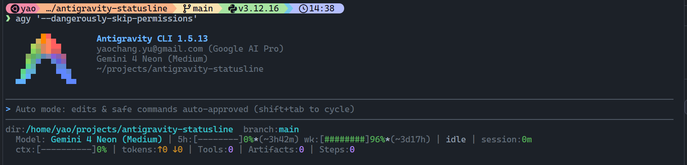

# Antigravity Statusline

[English](README.md) | [繁體中文](README.zh-TW.md)

A customizable Python statusline script for `antigravity-cli` (and Claude Code environments) that displays the current directory and Git branch, API rate limits, today's and this month's token usage, the current session's token usage, session duration, agent state, and active agent skills.



## Features

- **Directory & Git Status**: Displays the current directory name, the current branch, dirty status (`*`), and ahead/behind commits.
- **Model-Aware Rate Limits**: Shows used quota percentages (`%`) and reset countdowns for 5-hour and Weekly limits with custom progress bars (consistent with Orca/Claude statusline, turning red when quota is exhausted).
  - Automatically adapts quotas based on the active model: Argon models (such as `Orchestrator (Argon)` or `Gemini 4 Argon`) do not have a 5-hour quota limit, so the 5h indicator is omitted and only `argon-wk` is displayed; standard `5h` and `wk` limits are shown for Gemini and 3P models.
- **Usage Monitoring**: Shows today's and this month's token usage (`↑` input including cache, `↓` output) from `ccusage`, cached in the background. Hidden when `ccusage` is unavailable.
- **Session Tokens**: Shows the current session's input (`↑`) and output (`↓`) tokens next to the context usage bar.
- **Activity**: Shows the tool call count, artifact count, and step count from the session transcript.
- **Session & Agent State**: Shows the session duration in minutes and the current agent state (e.g. `idle`, `working`).
- **Active Skills**: Dynamically parses the session transcript to show the currently running skill (e.g. `write-yaochangyu-style`).
- **Requirements for usage**: `today` / `month` need `ccusage` to be runnable with `npx --no-install ccusage`; without it they are hidden.
- **ANSI Colors**: Consistent visual color schemes matching premium dark/gray themes.

## Prerequisites

- **Python 3**: The statusline renderer requires Python 3. You can verify if it's installed by running `python3 --version`.
  - On Ubuntu/Debian: `sudo apt update && sudo apt install -y python3`
  - On macOS: `brew install python`
  - On Windows (WSL): `sudo apt install python3`

## Installation

### AI Agent Installation Prompt

If you are using an AI coding assistant (like Antigravity or Claude Code), you can copy and paste the following prompt to let the agent do the installation for you:

> Please install the antigravity-statusline repository for me by running this remote Python installer:
> `python -c "import urllib.request; exec(urllib.request.urlopen('https://raw.githubusercontent.com/yaochangyu/antigravity-statusline/main/install.py').read())"`
> After running, verify the statusLine settings in my `~/.gemini/antigravity-cli/settings.json` file.

### 1. Remote Installation (Recommended)

You can run the installer directly using Python without cloning the repository:

```bash
python -c "import urllib.request; exec(urllib.request.urlopen('https://raw.githubusercontent.com/yaochangyu/antigravity-statusline/main/install.py').read())"
```

### 2. Local Installation (For Developers)

If you plan to customize the statusline, clone the repository and run the local installer:

```bash
git clone https://github.com/yaochangyu/antigravity-statusline.git
cd antigravity-statusline
python install.py
```

## How It Works & Configuration

By default, `antigravity-cli` reads its settings from `~/.gemini/antigravity-cli/settings.json`. To execute a custom statusline script, the `"statusLine"` block must be configured to point to `statusline.py`.

The installation script automatically configures this for you. If you wish to configure it manually, add the following to your `settings.json`. You can also enable automatic updates by adding `"autoUpdate": true` inside `"statusLine"` block (this will automatically overwrite the copy in config folder when a new version is detected, preserving symlinks for developers):

```json
{
  "statusLine": {
    "type": "command",
    "command": "python ~/.gemini/antigravity-cli/scratch/statusline.py",
    "enabled": true,
    "autoUpdate": true
  }
}
```

> [!NOTE]
> - On Unix/Linux/macOS systems, the installation script configures the command to use `python3` instead of `python` to match the default platform command.
> - On Windows, `~` is not expanded in `settings.json`. The installation script automatically configures the absolute path wrapped in quotes (e.g., `python "C:/Users/<Username>/.gemini/antigravity-cli/scratch/statusline.py"`).

## Update

The script features a background, non-blocking check that runs every 24 hours. If a new version is available on GitHub, an indicator badge `(🌟Update Available)` will be displayed on your statusline next to the session duration.

### 1. Upgrade from Older Versions / Remote Update (No git clone needed, Recommended)

If you have an older version installed (before the `autoUpdate` mechanism was introduced), or do not wish to clone the repository, run the following one-line Python command directly. It downloads the latest `statusline.py` from GitHub and overwrites your local installation while keeping your existing `settings.json` intact:

```bash
python -c "import urllib.request; exec(urllib.request.urlopen('https://raw.githubusercontent.com/yaochangyu/antigravity-statusline/main/update.py').read())"
```

> [!TIP]
> - On Linux / macOS / WSL systems where the default command is `python3`, replace the beginning with `python3 -c ...`.
> - To enable automatic background updates in the future, ensure `"autoUpdate": true` is added inside the `"statusLine"` block in your `settings.json`.

### 2. AI Agent Update Prompt

If you are using an AI coding assistant (like Antigravity or Claude Code), you can copy and paste the following prompt to let the agent update the statusline for you:

> Please update antigravity-statusline to the latest version by running this remote Python update script:
> `python -c "import urllib.request; exec(urllib.request.urlopen('https://raw.githubusercontent.com/yaochangyu/antigravity-statusline/main/update.py').read())"`
> Also verify that `"autoUpdate": true` is enabled in my `~/.gemini/antigravity-cli/settings.json` file.

### 3. Local Update (For Developers with a cloned repository)
If you previously cloned the repository, simply pull the latest changes and run the updater:

```bash
git pull origin main
python update.py
```

## Uninstallation

### 1. Remote Uninstallation
You can run the uninstaller directly from GitHub:

```bash
python -c "import urllib.request; exec(urllib.request.urlopen('https://raw.githubusercontent.com/yaochangyu/antigravity-statusline/main/uninstall.py').read())"
```

### 2. Local Uninstallation
Run the uninstaller script in the cloned repository directory:

```bash
python uninstall.py
```

