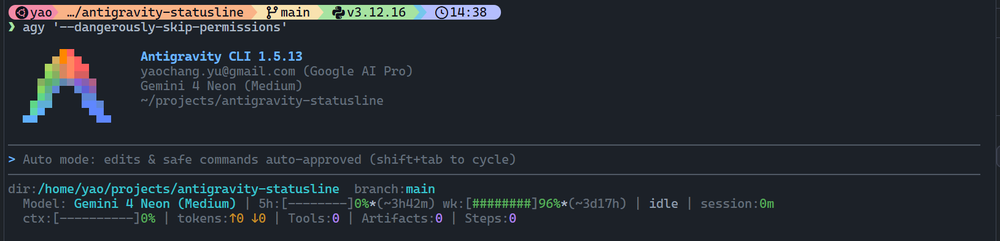

# Antigravity Statusline (繁體中文)

[English](README.md) | [繁體中文](README.zh-TW.md)

這是一個適用於 `antigravity-cli`（及 Claude Code 環境）的自訂 Python 地位列 (Statusline) 腳本。它能即時顯示 Git 分支資訊、API 額度限制、當前累積花費、Session 持續時間以及執行中的 Agent 技能。



## 功能特色

- **Git 狀態**：顯示當前分支、變動狀態 (`*`)，以及領先/落後 (ahead/behind) 的 commit 數量。
- **智慧模型額度辨識**：以彩色進度條顯示 API 額度損耗使用量百分比（`%`）與重置倒數（與 Orca / Claude statusline 一致，額度用盡時轉為紅色警示）。
  - 自動依當前模型切換配額欄位：使用 Argon 模型（如 `Orchestrator (Argon)`、`Gemini 4 Argon`）時，因其無 5 小時配額限制，會自動隱藏 5h 項目並僅顯示每週額度 `argon-wk`；使用一般 Gemini 或第三方模型則顯示標準的 `5h` 與 `wk`。
- **費用監控**：直接顯示今日與本月的 API 累計花費金額（不使用無謂的每日限制）。
- **真實技能偵測**：動態解析對話紀錄 (Transcript)，僅在載入真實技能（如 `write-yaochangyu-style`）時顯示。
- **自訂 ANSI 配色**：與 premium 暗色/灰色主題一致的精緻終端機配色。

## 系統需求與前置作業

- **Python 3**：地位列渲染腳本需要 Python 3。您可以執行 `python3 --version` 來檢查系統是否已安裝。
  - Ubuntu/Debian：`sudo apt update && sudo apt install -y python3`
  - macOS：`brew install python`
  - Windows (WSL)：`sudo apt install python3`

## 安裝步驟

### AI Agent 一鍵安裝提示詞 (Prompt)

如果您正使用 AI 程式助理（如 Antigravity 或 Claude Code）來設定此專案，您可以直接將以下提示詞複製發送給它：

> 請幫我安裝 antigravity-statusline 專案，執行以下遠端 Python 安裝腳本：
> `python -c "import urllib.request; exec(urllib.request.urlopen('https://raw.githubusercontent.com/yaochangyu/antigravity-statusline/main/install.py').read())"`
> 安裝完成後，請協助確認並檢查我電腦中的 `~/.gemini/antigravity-cli/settings.json` 設定檔是否已啟用 statusLine。

### 1. 遠端一鍵安裝（推薦）

您無須 clone 本儲存庫，可以直接透過 Python 一鍵執行 GitHub 上的安裝腳本：

```bash
python -c "import urllib.request; exec(urllib.request.urlopen('https://raw.githubusercontent.com/yaochangyu/antigravity-statusline/main/install.py').read())"
```

### 2. 本地開發安裝（適用於開發者）

如果您預計會自行客製化地位列腳本，請 clone 本儲存庫並執行本地安裝：

```bash
git clone https://github.com/yaochangyu/antigravity-statusline.git
cd antigravity-statusline
python install.py
```

## 運作原理與配置

預設情況下，`antigravity-cli` 會讀取 `~/.gemini/antigravity-cli/settings.json` 的設定檔。若要套用自訂的 statusline，必須在設定檔中的 `"statusLine"` 區塊配置執行路徑。

本專案的 `install.py` 安裝腳本會**自動為您修改此配置**。若您希望手動設定，請在您的 `settings.json` 中加入以下屬性。您也可以透過在 `"statusLine"` 區塊中添加 `"autoUpdate": true` 來啟用自動更新功能（這會在偵測到新版本時自動下載並覆蓋實體檔案，同時也會保護開發者的軟連結不受影響）：

```json
{
  "statusLine": {
    "type": "command",
    "command": "python ~/.gemini/antigravity-cli/scratch/statusline.py",
    "enabled": true,
    "autoUpdate": true
  }
}
```

> [!NOTE]
> - 在 Unix/Linux/macOS 系統上，安裝腳本會自動將指令配置為使用 `python3` 而非 `python`，以符合平台預設指令名稱。
> - 在 Windows 系統上，`settings.json` 的指令不支援波浪號 `~` 路徑展開。安裝腳本會自動為您替換為包覆雙引號的絕對路徑（例如 `python "C:/Users/<Username>/.gemini/antigravity-cli/scratch/statusline.py"`）。

## 更新腳本

地位列腳本具備背景非阻塞式的自動檢查機制，每 24 小時會自動在背景偵測 GitHub 上是否有新版本。如果有可用更新，將在您的地位列 session 時間旁亮起 `(🌟Update Available)` 提示徽章。

### 1. 舊版升級 / 遠端一鍵更新（無須 git clone，推薦）

如果您先前已安裝過舊版本（當時尚未具備 `autoUpdate` 自動更新機制），或者不想 clone 儲存庫，可以直接執行以下單行 Python 指令。它會從 GitHub 下載最新版的 `statusline.py` 覆蓋本機安裝，並保留現有的 `settings.json` 配置：

```bash
python -c "import urllib.request; exec(urllib.request.urlopen('https://raw.githubusercontent.com/yaochangyu/antigravity-statusline/main/update.py').read())"
```

> [!TIP]
> - 在 Linux / macOS / WSL 環境中，若預設指令為 `python3`，請將開頭改為 `python3 -c ...`。
> - 若希望未來自動接收更新，請確保 `~/.gemini/antigravity-cli/settings.json` 的 `"statusLine"` 區塊內已加入 `"autoUpdate": true`。

### 2. AI Agent 一鍵更新提示詞 (Prompt)

如果您正在使用 Antigravity 或 Claude Code 等 AI 助理，可以直接複製發送以下提示詞，讓 Agent 替您更新：

> 請幫我更新 antigravity-statusline 到最新版，直接執行遠端更新腳本：
> `python -c "import urllib.request; exec(urllib.request.urlopen('https://raw.githubusercontent.com/yaochangyu/antigravity-statusline/main/update.py').read())"`
> 並確保我 `settings.json` 內的 `statusLine` 區塊已設定 `"autoUpdate": true`。

### 3. 本地更新（適用於已有 clone 儲存庫的開發者）
若您先前已 clone 本儲存庫，在目錄中拉取最新代碼並執行更新腳本即可：

```bash
git pull origin main
python update.py
```

## 解除安裝

### 1. 遠端解除安裝
您可以直接從 GitHub 執行移除腳本：

```bash
python -c "import urllib.request; exec(urllib.request.urlopen('https://raw.githubusercontent.com/yaochangyu/antigravity-statusline/main/uninstall.py').read())"
```

### 2. 本地解除安裝
在 clone 的儲存庫目錄中執行移除指令：

```bash
python uninstall.py
```
